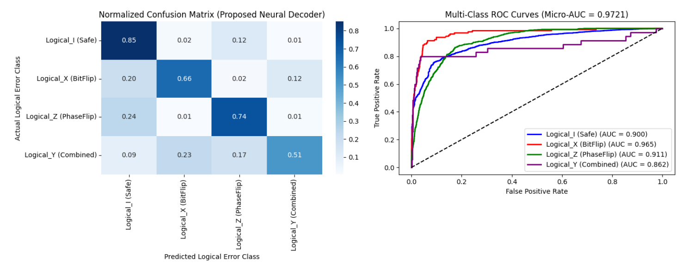

# Neural Syndrome Decoder for Imbalanced Syndrome Data

**Author:** Surat Sai Venkata Nagendra Babu, B.Tech CSE, Amrita Vishwa Vidyapeetham

A proof-of-concept study inspired by the work of Prof. Daniel Lidar's group. It uses my own simulated data (not data from the papers cited below).

## 1. Motivation
In quantum error correction, a decoder reads repeated syndrome measurements to infer what went wrong. Most runs are error-free and serious logical errors are rare, so the data is highly imbalanced. I had worked on the same kind of imbalance in my medical-imaging paper (*A Hybrid Deep Learning Approach for Multi-Class Eye Disease Classification*, accepted for Springer LNEE, in production), and this project tests whether those tools transfer to decoding.

Inspired by:
- **Shen et al. (2026), QMCtwin**, [arXiv:2606.19848](https://arxiv.org/abs/2606.19848): realistic noise (T1 relaxation, dephasing, ZZ crosstalk) produces syndrome statistics that Pauli models miss; the authors suggest neural decoders could be trained on such data.
- **Vezvaee et al. (2026)**, [arXiv:2510.18847](https://arxiv.org/abs/2510.18847): surface-code scaling on IBM heavy-hex processors.

## 2. Simulated dataset (generated in the notebook)
- 25,000 shots, 6 syndrome rounds, 9 data qubits, 8 syndrome checks.
- Biased X/Z flips, occasional extra Z flips, correlated flips on neighboring qubit pairs, and readout flips that are more likely in one direction.
- Input: the change in syndrome between rounds, shape `(6, 3, 3, 1)`.
- Label: `I`, `X`, `Z`, `Y`, assigned by a simple rule on the final accumulated errors.

| Class | Samples | Share |
| :--- | ---: | ---: |
| Logical_I | 20,072 | 80.29% |
| Logical_Z | 3,861 | 15.44% |
| Logical_X | 834 | 3.34% |
| Logical_Y | 233 | 0.93% |

Max imbalance 86.1:1. Stratified 70/15/15 split (seed 42); the test set has 3,750 shots, 35 of them Logical_Y.

## 3. Model and training
1. Two branches per round (`TimeDistributed`): a 3x3 convolution with channel and spatial attention (CBAM), and a 2x2 convolution for local patterns.
2. Bidirectional LSTM across the 6 rounds, then a softmax over 4 classes.
3. Damped focal loss: class weights proportional to (N_max / N_c)^0.35, gamma = 1.5, label smoothing 0.02; cosine learning-rate decay; early stopping.
4. Class-probability rescaling tuned on validation data.

Baseline: MLP (dense 64, dense 32) with cross-entropy.

## 4. Results (3,750 test shots, seed 42)
| Class | Baseline recall | Proposed recall | Baseline F1 | Proposed F1 |
| :--- | ---: | ---: | ---: | ---: |
| Logical_I | 96.28% | 85.09% | 89.96% | 89.25% |
| Logical_X | 16.00% | 66.40% | 23.26% | 58.87% |
| Logical_Z | 28.15% | 74.09% | 38.44% | 61.95% |
| Logical_Y | 0.00% | 51.43% (18/35) | 0.00% | 39.13% |
| **Macro F1** | | | **37.92%** | **62.30%** |

Overall accuracy is similar (82.19% vs 82.45%); micro-average ROC-AUC 0.9721. The decoder detects many more rare errors, with some additional false alarms on error-free shots.

## 5. Scope and next steps
This version uses simulated Pauli-type noise, a simple labeling rule, and one random seed. Next:
1. Rebuild the data with Stim and decode with PyMatching.
2. Add a class-weighted MLP baseline and ablations (loss vs. architecture).
3. Report mean and standard deviation over several seeds.
4. Test on QMCtwin-style syndrome data.

## 6. References
1. Harshith, Y. S., et al. (2026). *A Hybrid Deep Learning Approach for Multi-Class Eye Disease Classification.* Springer LNEE, Confluence 2026 proceedings (accepted, in production).
2. Shen, T., et al. (2026). *QMCtwin: Master-Equation Simulation of Syndrome Statistics Beyond Pauli Noise.* arXiv:2606.19848.
3. Vezvaee, A., et al. (2026). *Surface code scaling on heavy-hex superconducting quantum processors.* arXiv:2510.18847.

